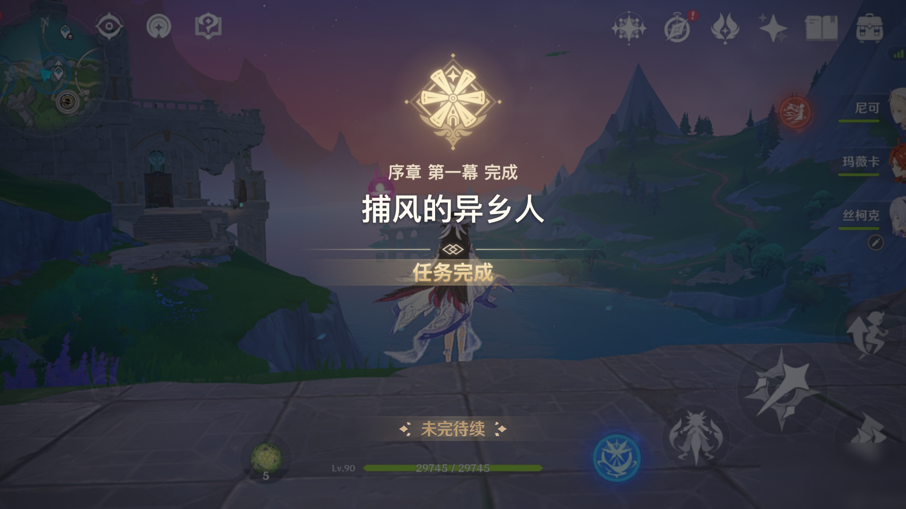

# 提瓦特任务影像工坊

把一张截图变成「任务完成」时刻的本地网页工具。上传图片或视频后，可以编辑任务文字、切换地区徽记、调整遮罩与粒子，然后导出带任务完成风格叠层的 PNG 图片或动画视频。

当前版本：**1.8**（徽记多轨迹、本地 H.265 导出版）· 作者 **[Morri-Echo](https://github.com/Morri-Echo)**

> 非官方同人工具：代码以 AGPL-3.0 开源；《原神》相关素材版权归 © miHoYo / HoYoverse 所有，详见文末[许可与素材声明](#许可与素材声明)。



## 功能

- **媒体上传**：支持本地图片和视频，上传后即时预览，输出尺寸可选 `16:9`、`4:3`、`9:16`、`8K` 或沿用原媒体比例。
- **文字编辑**：画面中的两行任务文字均可自定义，随动画时间线一起入场。
- **十三种任务徽记**：蒙德、璃月、稻妻、须弥、枫丹、纳塔、空月之歌、至冬、大赤沙海、沉玉谷、悠悠度假村、空之神殿、幻想真境剧诗。
- **遮罩与粒子**：遮罩颜色、透明度和粒子强度（关闭 / 克制 / 发布感）均可调。
- **七类徽记光效**：烟环绽放、十字星芒、双环光轮、斜向流光、金色涟漪、粒子汇聚与环绕星屑；可单独选择、按徽记自动匹配，也可开启全效果仪式，统一强度可调。
- **八类徽记入场**：下方升起、缩放回弹、旋转展开、左右滑入、翻转显形、螺旋汇聚与上方落定；可与光效独立组合，也可按不同徽记自动匹配。
- **金色文字底带**：“任务完成”和“未完待续”均使用可调强度的金色渐变光带。
- **动画预览**：任务文字、徽记与粒子的统一时间线，可先预览再导出。
- **双格式导出**：PNG 图片；动画视频由本地 Python + FFmpeg 生成 H.265 MP4，支持标准 8K（7680×4320）以及相机原尺寸 8256×5504。
- **工作台皮肤**：本地循环背景视频与交互式 3D 景深粒子，仅作编辑器外观，不会进入导出画面。

上传的媒体与视频帧只在当前电脑的浏览器和 `127.0.0.1` 本地服务之间处理，不会上传到互联网。

## 快速开始

### 本地运行

项目已把 FFmpeg 运行依赖安装在 `vendor/`。在项目目录启动本地网页与编码服务：

```powershell
python3 server.py
```

然后访问 <http://127.0.0.1:8000/index.html>。

不建议直接双击 `index.html`——浏览器对 `file://` 的资源限制可能导致图片、视频或导出模块加载失败。

## 使用方法

1. 点击「选择文件」，上传本地图片或视频。
2. 修改两行任务文字。
3. 选择输出尺寸，调整遮罩颜色与透明度。
4. 选择任务徽记、徽记动画效果和粒子效果档位。
5. 在右侧画布检查效果，按需「预览动画」。
6. 选择导出格式（PNG 图片 / MP4 动画），点击导出。

## 项目结构

```text
.
├─ index.html                    页面结构
├─ server.py                     本地网页服务与 H.265 MP4 编码接口
├─ js/                           页面脚本
│  ├─ renderer-core.js           渲染状态、尺寸和动画计算
│  ├─ script.js                  媒体加载、Canvas 绘制与导出
│  └─ editor-particles.js        编辑器 3D 景深粒子和背景视频控制
├─ css/
│  └─ styles.css                 工作台与响应式界面样式
├─ assets/                       徽记、装饰和轻量工作台背景
│  └─ preview/                   编辑器预览用的小尺寸徽记（512px）
├─ docs/
│  ├─ reference/                 视觉参考图
│  └─ specs/                     功能设计说明
├─ tests/                        Node.js 单元测试与 Edge 冒烟测试
│  └─ fixtures/                  冒烟测试上传用图片
├─ tools/                        素材维护脚本（可选，需要 Pillow）
├─ outputs/
│  ├─ task-overlay-sample.png    README 展示图
│  └─ *.mp4                      本地视频导出结果
├─ vendor/                       项目内 FFmpeg 运行依赖
└─ samples/                      本地示例与素材视频（不入库）
```

## 开发与测试

测试使用系统已安装的 Node.js，无需第三方依赖：

```powershell
node --check js/renderer-core.js
node --check js/script.js
node --check js/editor-particles.js
node tests\renderer-core.test.js
node tests\clean-assets.test.js
node tests\static-ui.test.js
node tests\emblem-loading.test.js
```

启动本地服务器后，可以运行 Edge 冒烟测试（需要本机安装 Microsoft Edge）。它会逐一渲染十三种徽记、校验渲染结果互不相同，并刷新 `outputs/task-overlay-sample.png`：

```powershell
python3 server.py
node tests\edge-smoke.js
```

## 新增任务徽记

1. 把新徽记的透明底 PNG（建议 2446×2446，RGBA）放入 `assets/`。
2. 运行素材脚本，自动统一到现有金色系并生成 512px 预览图：

   ```powershell
   python tools\prepare-emblem.py assets\<新徽记>.png
   ```

3. 在 `js/renderer-core.js`（`EMBLEM_KEYS`）、`js/script.js`（`EMBLEM_ASSETS`）和 `index.html`（下拉选项）中按现有条目注册。
4. 运行上面的测试确认通过。

## 视频导出说明

- PNG 导出保持当前静态画面布局。
- 图片生成的动画视频固定为精确 3.0 秒（30 fps、90 帧），与标准 Live Photo 的三秒动态时长一致。
- 动画视频会把背景媒体逐帧绘制进任务动画时间线，导出结果不包含源视频音轨。
- Chrome 只负责上传、编辑、预览和逐帧渲染文字、徽记与粒子；本地 Python 服务把 JPEG 帧流交给 FFmpeg `libx265` 软件编码器。
- 选择「原图比例」时，视频最高保留 8256×5504；选择「8K」时输出 7680×4320。
- H.265 MP4 使用 `hvc1` 标记和 YUV 4:2:0 像素格式。8256×5504 超过常见硬件 8K 解码档位，部分播放器可能改用软件解码或无法播放。
- 软件编码原尺寸视频需要较多 CPU 和时间，但按帧流式处理，不会在 Python 内存中同时保存全部画面。
- 导出文件写入项目的 `outputs/` 文件夹；页面也会保留可手动点击的下载链接。
- 若没有通过 `python3 server.py` 启动，本地服务不可用时，标准 8K 及以下仍会尝试原有浏览器 MP4/WebM 备用路径。

## 许可与素材声明

### 代码许可与出处

本项目代码（页面、`js/`、`css/`、`tests/`、`tools/`）由 **Morri-Echo** 开发，以 [GNU AGPL-3.0](LICENSE) 协议开源：可以自由使用、修改和再分发；修改后若以网络服务形式对外提供，需按同一协议开源，具体条款见 [LICENSE](LICENSE)。

任何使用、修改或再分发本项目代码的行为，都必须注明出处：

- 保留代码与仓库中原有的版权及许可声明；
- 以明显方式标注原作者 **Morri-Echo** 与原仓库地址：<https://github.com/Morri-Echo/yuanshen>。

### 素材版权

仓库中的以下内容**不在**上述代码许可范围内，取自米哈游《原神》，版权归 **© miHoYo / HoYoverse** 所有：

- `assets/` 下的十三种地区任务徽记图标（含 `preview/` 预览小图）
- `assets/weiwandaixu-clean.png`「未完待续」装饰图
- `assets/workbench-background.webm` 工作台背景视频
- `docs/reference/`、`tests/fixtures/`、`outputs/` 中的游戏截图与参考图

这些素材仅随本工具作非商业的同人展示用途，使用时应遵循米哈游官方发布的《原神》同人作品创作相关规范。
